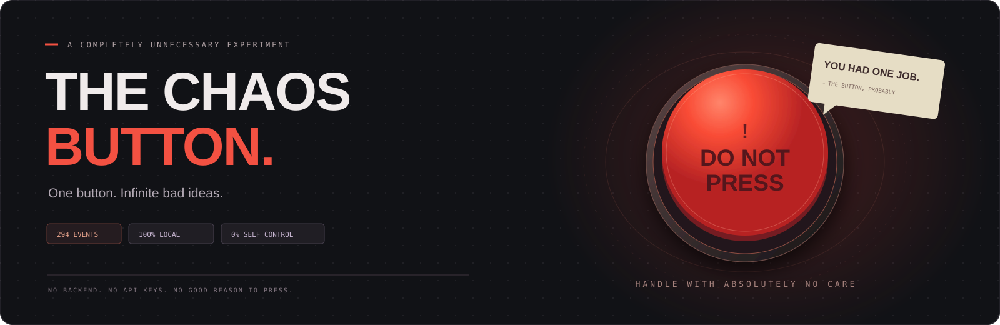
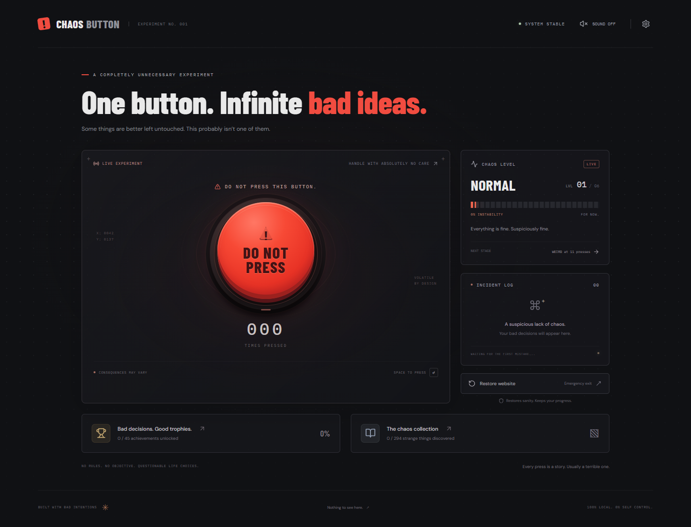
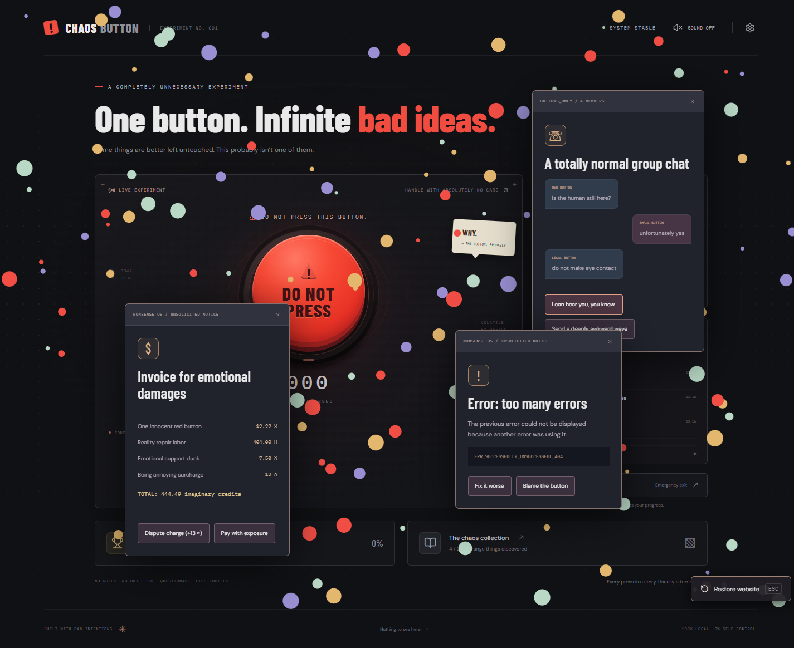

<div align="center">



**You had one job. Naturally, you pressed it.**

[](https://github.com/AlbertinoTheCoder/The-Chaos-Button/actions/workflows/ci.yml)


[Get started](#get-started) · [How to play](#how-to-play) · [Event catalog](docs/EVENTS.md) · [Contributing](CONTRIBUTING.md)

</div>

## One button. A very bad idea.

**The Chaos Button** is a browser game about ignoring one extremely clear instruction. Every press can unleash an interactive anomaly: arguing popups, broken gravity, tiny civilizations, physics toys, puzzles, or a button with a boss health bar and a personal grudge.

The website changes, reacts, and gets increasingly unreasonable. The windows are your problem: drag them around, pile them up, and close them yourself. The soundtrack starts suspiciously calm and gradually loses its mind with you.

**Everything runs locally. No backend. No accounts. No API keys. No gameplay AI calls.**



## What is inside?

| A questionable feature                | What it actually does                                                                                                                  |
| ------------------------------------- | -------------------------------------------------------------------------------------------------------------------------------------- |
| **294 discoverable events**           | Real DOM changes, simulated physics, characters, visual effects, and interactive scenes—not just random text.                          |
| **30 expansion mechanic families**    | Slingshots, pinball, wiring, gardening, herding, alchemy, mirrored controls, a fake stock market, and more, each with five variations. |
| **Windows without adult supervision** | Draggable popups accumulate indefinitely, support independent duplicates, and never close just because there are too many.             |
| **Three named bosses**                | Fight the Angry Button, the System Administrator, and Chaos Itself, with health, phases, victories, losses, and replay.                |
| **45 achievements and local saves**   | Keep discoveries, presses, trophies, secrets, boss victories, endings, and preferences across visits.                                  |
| **47 procedural sound effects**       | Distinct feedback for controls, windows, physical impacts, puzzle actions, boss attacks, and results.                                  |
| **Six-stage adaptive music**          | Ambient synths become drums, bass, frantic arpeggios, distortion, and glitch fills, rising from 68 to 188 BPM.                         |
| **An emergency exit**                 | Restore Website clears the mess while preserving your saved progress.                                                                  |



## Get started

Use **Node.js 24** or **22.12+** with npm.

```sh
git clone https://github.com/AlbertinoTheCoder/The-Chaos-Button.git
cd The-Chaos-Button
npm ci
npm run dev
```

Open the local URL printed by Vite, usually **http://127.0.0.1:5173/**. Press the button. Take responsibility for what happens next.

| Command                | Purpose                                                                          |
| ---------------------- | -------------------------------------------------------------------------------- |
| `npm run dev`          | Start the local development server.                                              |
| `npm test`             | Run the automated event, persistence, audio, music, and window-lifecycle checks. |
| `npm run build`        | Type-check and generate the static production build in `dist/`.                  |
| `npm run preview`      | Serve the production build locally.                                              |
| `npm run format:check` | Check consistent source and documentation formatting.                            |

All fonts and game assets are bundled. The production build is static and can be served by a static HTTP host. The game makes no external requests during play.

## How to play

- **Press:** click or tap the big red button, or use **Space**.
- **Move windows:** drag their title bars with your mouse or finger. Clicking a window brings it forward.
- **Play challenges:** use the instructions inside each minigame. Most Canvas scenes support pointer/touch controls and arrow keys; combat also uses WASD and Space.
- **After a minigame:** the main **✕ Close** button gets you back to the chaos. **Another attempt** lives at the top right.
- **Recover:** click **Restore Website** or press **Escape**. Saved progress stays intact.
- **Hear the damage:** turn **SOUND ON** in the header. Settings has master volume, an independent music toggle, and music volume.
- **Explore directly:** the event collection’s **Laboratory mode** can replay every event. It records discoveries, so leave it off if you want to find surprises naturally.

The soundtrack advances with both button progression and playtime. Music pauses in background tabs, and the main mute switch silences music and sound effects together. Reduced-motion preferences are respected.

<details>
<summary><strong>Progression: things get worse in six stages</strong></summary>

| Stage                | Presses | Diagnosis                                    |
| -------------------- | ------- | -------------------------------------------- |
| 1 · Normal           | 0–10    | Suspiciously fine.                           |
| 2 · Weird            | 11–30   | The website has opinions.                    |
| 3 · Unstable         | 31–60   | Gravity has become negotiable.               |
| 4 · Anarchy          | 61–100  | The interface has chosen violence.           |
| 5 · Reality Collapse | 101–150 | Larger disasters and legendary events.       |
| 6 · Beyond Chaos     | 151+    | A small administrative issue with existence. |

Event selection uses rarity weights, recent-event and mechanic-family cooldowns, and a preference for undiscovered content. Presses mix popup incidents, visual spectacles, and interactive events rather than repeatedly handing you minigames.

</details>

## Built for delightful disasters

React · TypeScript · Vite · Canvas 2D · Web Audio · localStorage

The source is split into focused systems for event selection, window ownership, game scenes, physics, persistence, sound, and music. See the [architecture guide](docs/ARCHITECTURE.md) and [full event catalog](docs/EVENTS.md) for implementation details.

Fake errors, terminals, desktops, invoices, and computer disasters are all contained inside the webpage. They never access your files, send emails, run destructive commands, or open uncontrolled browser windows.

## Add your own bad idea

New anomalies and focused fixes are welcome. Read [CONTRIBUTING.md](CONTRIBUTING.md), run the checks, and make sure the player can still close, restart, and recover from your creation.

Licensed under the [MIT License](LICENSE).

---

<div align="center">

**Built with bad intentions. Played with worse impulse control.**

</div>
